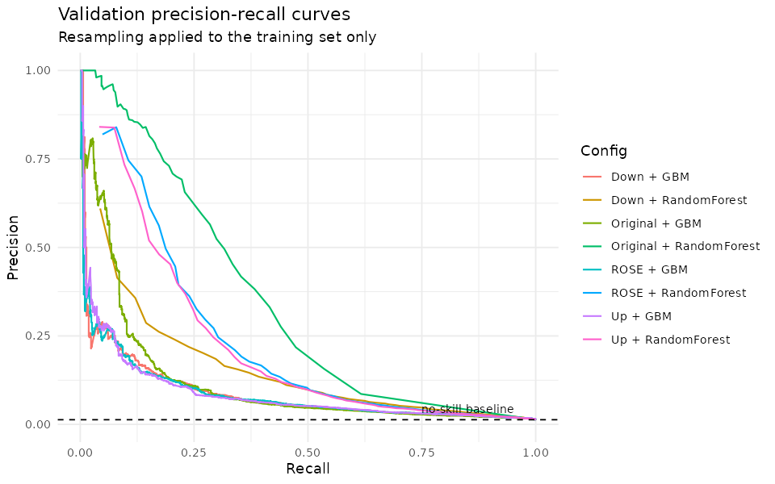

# Phishing Email Detection (R)

Can eight simple count features (words, links, domains, email addresses, spelling errors, urgent keywords) flag phishing email when only **1.3%** of messages are phishing, and does rebalancing the training data help? On 524,846 emails, a plain **Random Forest trained on the original (un-resampled) data** works best: test **PR-AUC 0.32** against a no-skill baseline of 0.013. At a threshold chosen on validation, it catches **30%** of phishing with **51%** precision. Down-sampling, up-sampling and ROSE all *lowered* PR-AUC. The features carry real signal, but not enough for a stand-alone filter.

Full report: [`phishing_email_analysis.html`](phishing_email_analysis.html) (download and open in a browser), source in [`phishing_email_analysis.Rmd`](phishing_email_analysis.Rmd). An earlier version is on [RPubs](https://rpubs.com/lukahere007/1299856). It used a 50k-row subsample and an older protocol, so its numbers differ from those below.

## Results

**Validation set** (104,969 emails, 1,390 phishing). Each model is trained on one version of the training set. The threshold is the F1-maximising one on validation.

| Training data | Model | PR-AUC | ROC-AUC | Threshold | Precision | Recall | F1 |
|---|---|---:|---:|---:|---:|---:|---:|
| **Original** | **Random Forest** | **0.320** | 0.782 | 0.08 | 0.495 | 0.317 | 0.386 |
| ROSE | Random Forest | 0.228 | 0.843 | 0.90 | 0.362 | 0.240 | 0.288 |
| Up-sampled | Random Forest | 0.216 | 0.840 | 0.90 | 0.369 | 0.231 | 0.284 |
| Down-sampled | Random Forest | 0.148 | 0.855 | 0.92 | 0.202 | 0.270 | 0.231 |
| Original | GBM | 0.117 | 0.785 | 0.07 | 0.216 | 0.139 | 0.169 |
| Down-sampled | GBM | 0.089 | 0.799 | 0.76 | 0.141 | 0.181 | 0.158 |
| Up-sampled | GBM | 0.087 | 0.800 | 0.75 | 0.129 | 0.178 | 0.150 |
| ROSE | GBM | 0.086 | 0.801 | 0.74 | 0.124 | 0.203 | 0.154 |
| *No-skill baseline* | | *0.013* | *0.5* | | | | |



**Test set, used once** (104,968 emails, 1,389 phishing). Champion: Original + Random Forest. Both thresholds were fixed on validation.

| Operating point | Threshold | Precision | Recall | F1 | Flagged | Phishing caught |
|---|---:|---:|---:|---:|---:|---:|
| F1-optimal | 0.08 | 0.508 | 0.300 | 0.377 | 821 | 417 of 1,389 |
| High-recall (≥ 50% on validation) | 0.01 | 0.157 | 0.544 | 0.243 | 4,830 | 756 of 1,389 |

Test PR-AUC 0.322, ROC-AUC 0.797. The validation and test numbers agree closely, so the threshold choice did not overfit.



### Key findings

- **Resampling hurt.** Every resampled model had a *higher* ROC-AUC but a *lower* PR-AUC than its un-resampled counterpart. Rebalancing improves ranking across the whole range but damages the high-precision end, which is the part that matters when ~99% of mail is legitimate.
- **Random Forest beat GBM** by a wide margin on PR-AUC (0.32 vs 0.12 on original data). These GBM settings (100 trees, depth 3) are fairly shallow; they were not tuned.
- **Recall is expensive.** Going from 30% to 54% recall drops precision from 51% to 16%, about 5 false alarms per real phish caught.
- **Duplicate feature vectors flatter the score a little.** 61% of rows share their exact 8-feature vector with an earlier row (short and templated emails collide). On test emails whose vector never appears in training (29% of test), PR-AUC is 0.299 against a 0.035 baseline. Recall at the chosen threshold is 0.28 and precision 0.46. That is lower than on the full test set, but the model still clearly works.

## Method

1. Stratified split of all 524,846 rows: 60% train / 20% validation / 20% test (`set.seed(42)`, `caret::createDataPartition`).
2. Four versions of the **training set only**: original, `downSample`, `upSample`, and ROSE (`ovun.sample(method = "both")`). Validation and test keep the true 1.3% phishing rate.
3. Random Forest (`randomForest`, 100 trees) and GBM (`gbm`, 100 trees, depth 3, learning rate 0.1) fitted on each version, giving 8 configurations.
4. Configurations are compared on **validation PR-AUC** (average precision). The champion's threshold is chosen on validation, by scanning 0.01 to 0.99 and taking the F1 maximum. A high-recall threshold is also chosen on validation: the highest threshold with recall ≥ 50%.
5. The champion is scored **once** on the test set. It is not refit on train + validation, because refitting shifts the probability scale and would invalidate the validation-tuned threshold.

Accuracy is not reported. Always predicting "not phishing" scores 98.7%.

## What changed from the original version

- **Test set was used for model selection.** The old notebook evaluated three configurations on the test set. Its README then recommended a model based on those test numbers. Thresholds `0.09`/`0.06` were also hard-coded from an earlier run. Now the champion and threshold are picked on validation, and test is touched once.
- **Champion was picked by maximum recall.** This favoured a model with 4.8% precision. Selection now uses PR-AUC, which suits a 1.3% positive rate.
- **Silent 50k-row subsample.** The old analysis used a 50,000-row random sample, which the README did not mention. It now uses all rows, about 6 minutes on 4 cores.
- **Hard-coded Windows path** (`C:/Users/...`) replaced with a relative path. The Rmd was renamed to remove spaces and is now rendered to HTML.
- Added PR-AUC, ROC-AUC, a no-skill baseline, PR curves, and the duplicate-vector check.

## Run it

Requires R ≥ 4.3 and pandoc (bundled with RStudio).

```r
install.packages(c("rmarkdown", "knitr", "caret", "ROSE", "randomForest",
                   "gbm", "pROC", "ggplot2"))
rmarkdown::render("phishing_email_analysis.Rmd")
```

Rendering regenerates `phishing_email_analysis.html` and `figures/`. It takes about 6 minutes on a 4-core machine with all 525k rows.

## Data

[Email Phishing Dataset](https://www.kaggle.com/datasets/ethancratchley/email-phishing-dataset/data) by Ethan Cratchley (Kaggle), committed as `email_phishing_data.csv` (11.8 MB). It has 8 numeric features extracted from each email and a `label` column (1 = phishing). The raw email text is not included.

## Repository layout

```
├── phishing_email_analysis.Rmd    # analysis source
├── phishing_email_analysis.html   # rendered report
├── email_phishing_data.csv        # dataset
├── figures/                       # plots written by the Rmd
└── LICENSE
```

## Limitations

- **Features are thin.** Eight counts cannot see message content, sender reputation or URL targets, so the ~0.3 PR-AUC ceiling reflects the features as much as the models.
- **No hyperparameter tuning.** Both models use fixed settings. A tuned GBM (more trees, deeper, early stopping) may close the gap with Random Forest.
- **Single split.** The results come from one random split, without confidence intervals. With ~1,390 phishing emails per evaluation set the estimates are reasonably stable, but repeated CV would quantify that.
- **Random rather than time-based split.** The dataset has no dates, so performance on future phishing campaigns is untested.

## License

MIT, see [LICENSE](LICENSE).
